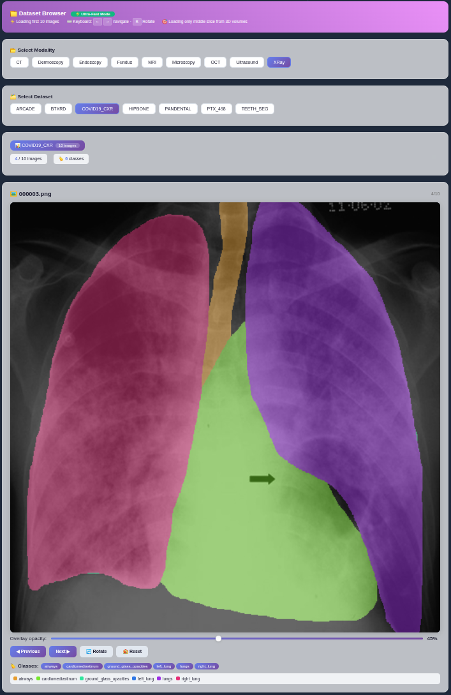
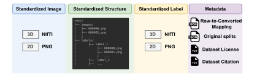
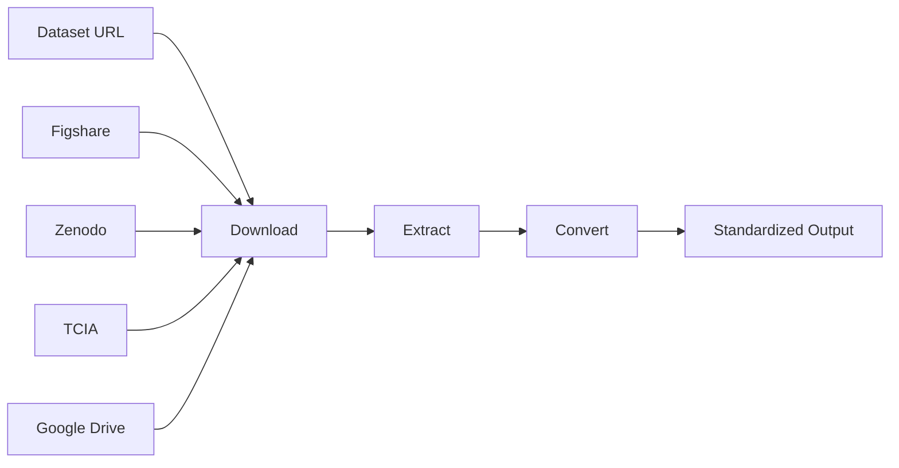

# 🏥 OmniMedSeg

<p align="center">
  
</p>

<div align="center">

[](https://www.python.org/downloads/)
[](https://opensource.org/licenses/MIT)
[](https://zrrr1997.github.io/omnimedseg-datasets/)
[](https://zrrr1997.github.io/omnimedseg-datasets/)
[](http://makeapullrequest.com)

**A comprehensive tool for downloading, extracting, and converting medical imaging segmentation datasets into a standardized format.**

</div>

---

## 📊 Dataset Browser

**Explore all 155 datasets** in a searchable, sortable table with filters by modality, license, and more.

<p align="center">
  <a href="https://zrrr1997.github.io/omnimedseg-datasets/">
    
  </a>
  <a href="https://publikationen.bibliothek.kit.edu/1000194202">
    
  </a>
</p>

👉 **[https://zrrr1997.github.io/omnimedseg-datasets/](https://zrrr1997.github.io/omnimedseg-datasets/)**

---

## 📖 Overview

Medical image segmentation datasets are the foundation of modern deep learning in healthcare, yet *"public" rarely means "directly usable."* Datasets are scattered across incompatible formats, locked behind restrictive access procedures, and buried under idiosyncratic directory structures that demand weeks of engineering before any model can be trained.

**OmniMedSeg fixes this.** We provide a unified, large-scale benchmark of **155 open-licensed, directly accessible datasets** across **9 imaging modalities** — all standardized into a consistent format (PNG for 2D, NIfTI for 3D) with binary labels per class and full traceability to original sources. Behind the scenes, a modular three-layer pipeline automates everything, so you can focus on building models, not wrestling with data.

<p align="center">
  
  <br>
  <em>Figure 1: 155 datasets across 9 modalities.</em>
</p>

<p align="center">
  
  <br>
  <em>Figure 2: The messy reality of medical imaging data — before standardization.</em>
</p>

---

### Supported Modalities

<div align="center">

<!-- Modality badges with hover effects -->
<p align="center">
  <span style="background:#1e40af;color:white;padding:8px 20px;border-radius:25px;font-weight:600;display:inline-block;margin:4px;font-size:0.9rem;box-shadow:0 2px 8px rgba(30,64,175,0.3);">🏥 CT <sup style="font-weight:400;opacity:0.8;"></sup></span>
  <span style="background:#3730a3;color:white;padding:8px 20px;border-radius:25px;font-weight:600;display:inline-block;margin:4px;font-size:0.9rem;box-shadow:0 2px 8px rgba(55,48,163,0.3);">🧠 MRI <sup style="font-weight:400;opacity:0.8;"></sup></span>
  <span style="background:#9d174d;color:white;padding:8px 20px;border-radius:25px;font-weight:600;display:inline-block;margin:4px;font-size:0.9rem;box-shadow:0 2px 8px rgba(157,23,77,0.3);">👁️ Fundus <sup style="font-weight:400;opacity:0.8;"></sup></span>
  <span style="background:#065f46;color:white;padding:8px 20px;border-radius:25px;font-weight:600;display:inline-block;margin:4px;font-size:0.9rem;box-shadow:0 2px 8px rgba(6,95,70,0.3);">📡 Ultrasound <sup style="font-weight:400;opacity:0.8;"></sup></span>
  <span style="background:#92400e;color:white;padding:8px 20px;border-radius:25px;font-weight:600;display:inline-block;margin:4px;font-size:0.9rem;box-shadow:0 2px 8px rgba(146,64,14,0.3);">🔬 Microscopy <sup style="font-weight:400;opacity:0.8;"></sup></span>
  <span style="background:#78350f;color:white;padding:8px 20px;border-radius:25px;font-weight:600;display:inline-block;margin:4px;font-size:0.9rem;box-shadow:0 2px 8px rgba(120,53,15,0.3);">🏥 Endoscopy <sup style="font-weight:400;opacity:0.8;"></sup></span>
  <span style="background:#4338ca;color:white;padding:8px 20px;border-radius:25px;font-weight:600;display:inline-block;margin:4px;font-size:0.9rem;box-shadow:0 2px 8px rgba(67,56,202,0.3);">👁️ OCT <sup style="font-weight:400;opacity:0.8;"></sup></span>
  <span style="background:#7f1d1d;color:white;padding:8px 20px;border-radius:25px;font-weight:600;display:inline-block;margin:4px;font-size:0.9rem;box-shadow:0 2px 8px rgba(127,29,29,0.3);">🔍 Dermoscopy <sup style="font-weight:400;opacity:0.8;"></sup></span>
  <span style="background:#1f2937;color:white;padding:8px 20px;border-radius:25px;font-weight:600;display:inline-block;margin:4px;font-size:0.9rem;box-shadow:0 2px 8px rgba(31,41,55,0.3);">📷 X-Ray <sup style="font-weight:400;opacity:0.8;"></sup></span>
</p>

**📊 155 datasets across 9 modalities**

</div>

---

## ✨ Features

<table align="center">
  <tr>
    <td width="33%" align="center">
      <h3>🚀 Core Capabilities</h3>
      <ul align="left">
        <li><strong>155+ Datasets</strong> — One command access</li>
        <li><strong>9 Modalities</strong> — Comprehensive coverage</li>
        <li><strong>Standardized Output</strong> — Ready for ML pipelines</li>
        <li><strong>Parallel Processing</strong> — Fast multi-threading</li>
      </ul>
    </td>
    <td width="33%" align="center">
      <h3>📦 Download Management</h3>
      <ul align="left">
        <li><strong>Multi-source Support</strong> — Figshare, Zenodo, TCIA, Google Drive, GitHub</li>
        <li><strong>Integrity Checking</strong> — Verify downloaded files</li>
      </ul>
    </td>
    <td width="33%" align="center">
      <h3>🔧 Smart Tool Management</h3>
      <ul align="left">
        <li><strong>Automatic Installation</strong> — 7zip, unrar, dcm2niix, plastimatch</li>
        <li><strong>Path Management</strong> — Environment setup scripts included</li>
      </ul>
    </td>
  </tr>
</table>

---

## 🛠️ Installation

### Prerequisites

| Requirement | Version |
|-------------|---------|
| Python | 3.10+ |
| System | Linux |

### Quick Install

```bash
# Create environment
conda create -n omnimedseg python=3.10 -y
conda activate omnimedseg

# Clone the repository
git clone https://github.com/Zrrr1997/omnimedseg.git
cd omnimedseg

# Install the package (all dependencies are declared in pyproject.toml)
pip install -e .

# Install system dependencies (7zip, unrar, dcm2niix, plastimatch)
sh scripts/install_tools.sh
source setup_path.sh
```

> **Older Linux (glibc < 2.28, e.g. Ubuntu 18.04):** use `pip install --prefer-binary -e .`
> so pip picks prebuilt wheels instead of trying to compile `pyarrow` from source.

Optional extras:

```bash
pip install -e ".[datasetninja]"   # needed only for INTRARETINAL_CYSTOID_FLUID (datasetninja.com)
pip install -e ".[dev]"            # pytest, for running the test suite
```

### Running the tests

```bash
pytest -m "not golden"   # fast: imports, CLI, dataset registry (no data needed)
pytest -m golden         # re-converts HRF, KVASIR_SEG, MSD_SPLEEN and compares to stored checksums
```

The golden tests need the raw data on disk once:
`omnimedseg --dataset HRF --download --convert --keep_raw_data` (same for `KVASIR_SEG`, `MSD_SPLEEN`).

## 🎯 Usage

### Basic Commands

#### Download and Convert a Single Dataset

```bash
omnimedseg --dataset PAPILA --download --convert
```


#### Process All Datasets in a Modality

```bash
omnimedseg --modality Fundus --download --convert
```

#### Extract Only (Skip Download)

```bash
omnimedseg --dataset PAPILA --extract
```

#### Convert Without Re-downloading
```
omnimedseg --dataset PAPILA --convert --force_convert
```

#### Check Dataset Integrity
```
omnimedseg --dataset PAPILA --check_integrity
```

#### Keep Raw Data After Conversion
```
omnimedseg --dataset PAPILA --download --convert --keep_raw_data
```


### Visualize and Browse through Dataset Images
```
# Launch interactive dataset browser
omnimedseg --visualization

# With custom options
omnimedseg --visualization --port 8080 --max_images 20 # set max images per dataset to view
```
<p align="center">
  
  <br>
  <em>Figure 3: Our data visualization tool for an example chest X-Ray image.</em>
</p>


## 📁 Dataset Format
<p align="center">
  
  <br>
  <em>Figure 4: Our unified output format: PNG/NIfTI + binary labels + full metadata.</em>
</p>

## Standardized Output Structure
After conversion, each dataset follows this structure:
```
datasets/
└── [MODALITY]/
    └── [DATASET_NAME]/
        ├── converted/
        │   ├── images/
        │   │   ├── 000000.png
        │   │   ├── 000001.png
        │   │   └── ...
        │   ├── labels/
        │   │   ├── [label_type_1]/
        │   │   │   ├── 000000.png
        │   │   │   └── 000001.png
        │   │   ├── [label_type_2]/
        │   │   │   ├── 000000.png
        │   │   │   └── 000001.png
        │   │   └── ...
        │   └── filename_map.json
        ├── compressed/          # Original archives
        └── extracted/           # Raw extracted data
```

## filename_map.json
Tracks original file paths for reproducibility:
```
{
  "000000.png": {
    "image": "/path/to/original/image.jpg",
    "optic_disc": "/path/to/disc_contour.txt",
    "optic_cup": "/path/to/cup_contour.txt"
  },
  "000001.png": {
    "image": "/path/to/original/image.png",
    "optic_disc": "/path/to/disc_mask.png",
    "optic_cup": "/path/to/cup_mask.png"
  }
}
```


---


## 🔄 Pipeline Overview
<p align="center">
  
  <br>
  <em>Figure 5: The Download → Convert → Data pipeline.</em>
</p>




## 📝 Adding a New Dataset

1. Add the dataset download URL to `src/omnimedseg/core/constants.py`
2. Create a converter in `src/omnimedseg/converters/[modality]/[dataset].py` that defines
   `convert_<dataset_name_in_lowercase>()` (no required arguments). It is found automatically by name;
   helper functions may use any other name.
3. Run `pytest -m "not golden"` — it checks that every dataset resolves to exactly one converter
4. Make a PR

### Datasets that need a manual download

Some sources can no longer be downloaded automatically (currently: **BUSI**). For these,
`omnimedseg --dataset BUSI --download` stops with instructions on where to place the original archive
(e.g. `datasets/Ultrasound/BUSI/Dataset_BUSI.zip`); once it is there, the same command extracts it and
`--convert` works as usual. Failed or partial conversions are moved to `converted.failed/` and raw data is
kept, so nothing has to be downloaded twice.


## 🚀 What's Next?

### 🧠 Model Training (Coming Soon)

This dataset converter is the first step in building a comprehensive medical imaging benchmarking platform. **Model training is the next major feature** currently in development, which will include:

- **Unified Training Pipeline** - Train on any dataset with one command
- **Model Zoo** - A large pool of pre-trained models
- **Multi-modal Support** - Train on 2D and 3D data
- **Automatic Evaluation** - Compute standard metrics (Dice, IoU, Sensitivity, Specificity)
- **Visualization** - Visualize predictions on validation sets


---

